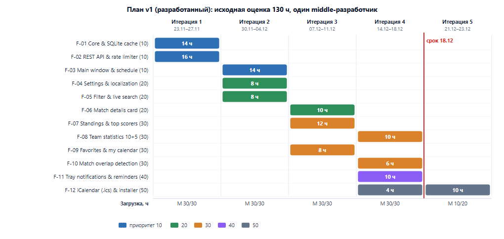
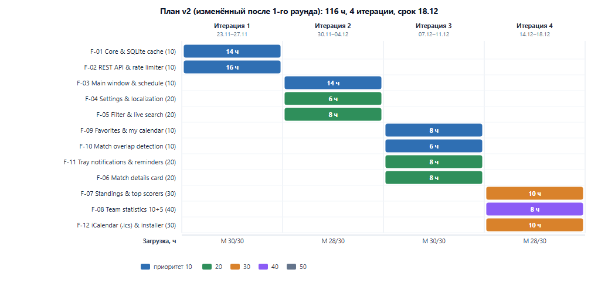
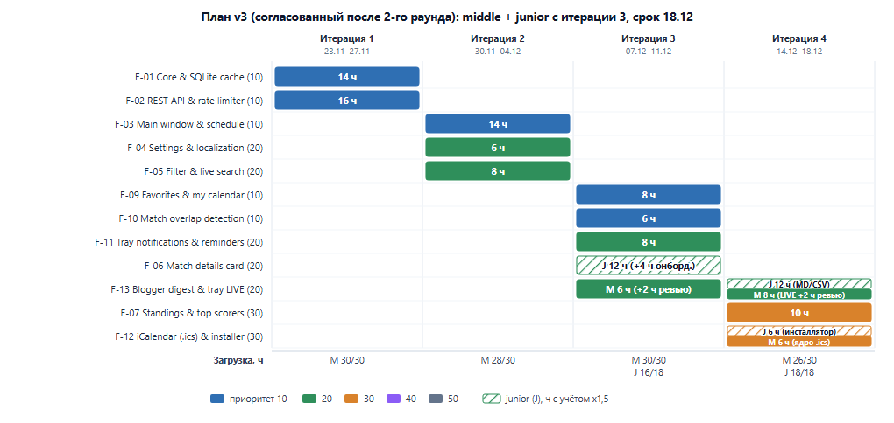

# План реализации «Футбольный календарь» (FootballCalendar) по итерациям

Версия 0.3 (согласована с Заказчиком 22.11.2026)

Подготовил: Коньков Я. А., гр. 434701 (Архитектор системы / Исполнитель)
Заказчик: Кузьминчук М. Ю., гр. 434701

## 1. Условия и параметры планирования

- **Длина итерации:** 1 рабочая неделя (Пн–Пт), в последний день итерации — демонстрация работающего инкремента Заказчику.
- **Полезная ёмкость 1 итерации (Middle / Architect):** `30 ч` (оплата по выделенным итерационным слотам: `40 BYN/ч`, полная неделя `30 ч = 1 200 BYN`).
- **Начало разработки:** `23.11.2026`.
- **Жёсткий срок выпуска (Deadline Заказчика):** `18.12.2026` (**4 итерации**, полезный ресурс Middle — `120 ч`).
- **Шкала приоритетов (EN):** `10` (*Highest / Release blocker*), `20` (*High / Necessary*), `30` (*Medium / Desirable*), `40` (*Low / Simplifiable*), `50` (*Lowest / Reserve*).
- **Условия подключения Junior-разработчика (в плане v3):** с Итерации 3 (`07.12.2026`) на половину ставки (`18 ч/нед.`, всего `36 ч`), ставка `15 BYN/ч`, коэффициент трудоёмкости `×1,5` от оценки Middle, `4 ч` на знакомство с проектом, `2 ч/итер.` у Middle на наставничество и Code Review (с учётом закона Брукса).

---

## 2. Сводка системных требований и эволюция оценок (v1 / v2 / v3)

| ID | Function (EN) | Требования SRS | Приоритет (`v1/v2/v3`) | Оценка Middle, ч (`v1/v2/v3`) |
|----|---------------|----------------|------------------------|-------------------------------|
| `SYS-F-01` | Core & SQLite cache | `C-1`, `C-4`, `REQ-PERF-001`, `REQ-REL-002`, `REQ-AVAIL-001` | `10 / 10 / 10` | `14 / 14 / 14` |
| `SYS-F-02` | Football-Data API client & rate limiter | `REQ-INT-002`, `REQ-FUNC-012`, `REQ-SEC-001`, `REQ-REL-001`, `REQ-PERF-002` | `10 / 10 / 10` | `16 / 16 / 16` |
| `SYS-F-03` | Main window & match schedule | `REQ-INT-001`, `REQ-FUNC-001`, `REQ-FUNC-013`, `REQ-COMP-001` | `10 / 10 / 10` | `14 / 14 / 14` |
| `SYS-F-04` | Settings, timezone & localization | `REQ-FUNC-014`, `REQ-SEC-002`, `REQ-SEC-003` | `20 / 20 / 20` | `8 / 6 / 6` |
| `SYS-F-05` | Tournament filter & live team search | `REQ-FUNC-002`, `REQ-FUNC-003` | `20 / 20 / 20` | `8 / 8 / 8` |
| `SYS-F-06` | Match details card & head-to-head | `REQ-FUNC-004` | `20 / 20 / 20` | `10 / 8 / 8` |
| `SYS-F-07` | Standings & top scorers | `REQ-FUNC-005`, `REQ-FUNC-006` | `30 / 30 / 30` | `12 / 10 / 10` |
| `SYS-F-08` | Team statistics & form (10+5) | `REQ-FUNC-007` *(отложено в v3)* | `30 / 40 / —` | `10 / 8 / —` |
| `SYS-F-09` | Favorites & personal calendar | `REQ-FUNC-008` | `30 / 10 / 10` | `8 / 8 / 8` |
| `SYS-F-10` | Match overlap detection | `REQ-FUNC-011` | `30 / 10 / 10` | `6 / 6 / 6` |
| `SYS-F-11` | Windows tray notifications & reminders | `REQ-INT-003`, `REQ-FUNC-009` | `40 / 20 / 20` | `10 / 8 / 8` |
| `SYS-F-12` | iCalendar (.ics) library, logger & release | `REQ-FUNC-010`, `REQ-OBS-001`, `REQ-COMP-002`, `REQ-COMP-003` | `50 / 30 / 30` | `14 / 10 / 10` |
| `SYS-F-13` | Blogger digest (MD/CSV) & tray LIVE menu | `REQ-FUNC-015` *(добавлено в v3)* | `— / — / 20` | `— / — / 22` |
| **Итого** | — | — | — | **`130 / 116 / 130`** |

---

## 3. План v1 (разработанный — до первого раунда обсуждения)

Первоначальная оценка полного объёма SRS составила **130 ч**, что не помещалось в 4 недельные итерации (`120 ч`) и требовало добавления 5-й короткой итерации с выпуском **23.12.2026** (стоимость `140 ч × 40 BYN = 5 600 BYN`).

---

## 4. План v2 (изменённый — по итогам первого раунда обсуждения)

После разъяснения трудоёмкости `F-02` и `F-12`, пересмотра приоритетов (`F-09`, `F-10` подняты до `10`, `F-11` до `20`, `F-08` понижен до `40`) и согласованных упрощений без потери бизнес-целей объём сокращён до **116 ч** (резерв `4 ч`). Работа уложилась в **4 итерации** с выпуском **18.12.2026** и стоимостью **`4 800 BYN`** (`120 × 40`).

| Итерация | Даты | Содержание | Загрузка Middle, ч |
|----------|------|------------|--------------------|
| 1 | 23.11–27.11 | `F-01` Ядро и кэш SQLite (14 ч), `F-02` API-клиент и RateLimiter (16 ч) | 30 из 30 |
| 2 | 30.11–04.12 | `F-03` Главное окно и офлайн-режим (14 ч), `F-04` Настройки (6 ч), `F-05` Фильтр и поиск (8 ч) | 28 из 30 |
| 3 | 07.12–11.12 | `F-09` Избранное (8 ч), `F-10` Пересечения матчей (6 ч), `F-11` Трей-уведомления (8 ч), `F-06` Карточка матча (8 ч) | 30 из 30 |
| 4 | 14.12–18.12 | `F-07` Таблицы и бомбардиры (10 ч), `F-08` Статистика команды (8 ч), `F-12` Библиотека `.ics`, логи и инсталлятор (10 ч) | 28 из 30 |

---

## 5. План v3 (согласованный — по итогам второго раунда с Junior-разработчиком)

Во втором раунде Заказчик отказался от `F-08` (`-8 ч`) и добавил **`F-13: Blogger digest (MD/CSV) & tray LIVE menu`** (`+22 ч`: `T-13.1` агрегация тура `6 ч`, `T-13.2` экспорт Markdown/CSV `8 ч`, `T-13.3` LIVE-меню трея и тесты `8 ч`). Новый объём (`130 ч`) при одном разработчике вновь сдвигал выпуск на `23.12.2026` с ростом стоимости до `5 600 BYN` (`+16,7 %`), что Заказчик отклонил.

Решением стало подключение **Junior C++ разработчика** с Итерации 3 (`18 ч/нед.`, всего `36 ч × 15 BYN = 540 BYN`, коэффициент `×1,5`, `4 ч` онбординг, `2 ч/итер.` ревью у Middle).

| Итерация | Даты | Задачи Middle (40 BYN/ч) | Задачи Junior (15 BYN/ч, ×1,5) | Загрузка, ч |
|----------|------|--------------------------|--------------------------------|-------------|
| 1 | 23.11–27.11 | `F-01` Ядро и кэш SQLite (14 ч), `F-02` API-клиент и RateLimiter (16 ч) | — | M 30/30 |
| 2 | 30.11–04.12 | `F-03` Главное окно (14 ч), `F-04` Настройки (6 ч), `F-05` Фильтр и поиск (8 ч) | — | M 28/30 |
| 3 | 07.12–11.12 | `F-09` Избранное (8 ч), `F-10` Пересечения (6 ч), `F-11` Трей-уведомления (8 ч), `T-13.1` Ядро сводки тура (6 ч), наставничество и ревью (2 ч) | Знакомство с проектом (4 ч), `F-06` Карточка матча `UI-02` (`8 × 1,5 = 12 ч`) | M 30/30 J 16/18 |
| 4 | 14.12–18.12 | `F-07` Таблицы и бомбардиры (10 ч), `T-13.3` LIVE-меню трея и тесты (8 ч), `F-12` Ядро `.ics` и логи (6 ч), наставничество и приёмка (2 ч) | `T-13.2` Экспорт MD/CSV (`8 × 1,5 = 12 ч`), `F-12` Установщик `windeployqt` и тесты RFC (`4 × 1,5 = 6 ч`) | M 26/30 J 18/18 |

---

## 6. Сравнение версий плана и стоимости

| Версия плана | Объём (оценка Middle), ч | Итераций | Выпуск | Middle (`ч × BYN`) | Junior (`ч × BYN`) | Итого, BYN | Отклонение от v2 |
|--------------|--------------------------|----------|--------|--------------------|--------------------|------------|------------------|
| `v1` — разработанный | 130 | 5 | 23.12.2026 | `140 × 40` | — | **5 600** | +800 BYN (+16,7 %, срыв срока) |
| `v2` — изменённый (после Раунда 1) | 116 (+4 рез.) | 4 | 18.12.2026 | `120 × 40` | — | **4 800** | Базовая линия |
| Вариант А Раунда 2 (без Junior) | 130 | 5 | 23.12.2026 | `140 × 40` | — | **5 600** | +800 BYN (+16,7 %, отклонён) |
| **`v3` — согласованный (с Junior)** | **130** (`114 M + 34 J`) | **4** | **18.12.2026** | **`120 × 40`** | **`36 × 15`** | **5 340** | **+540 BYN (+11,25 %, срок сохранён)** |
