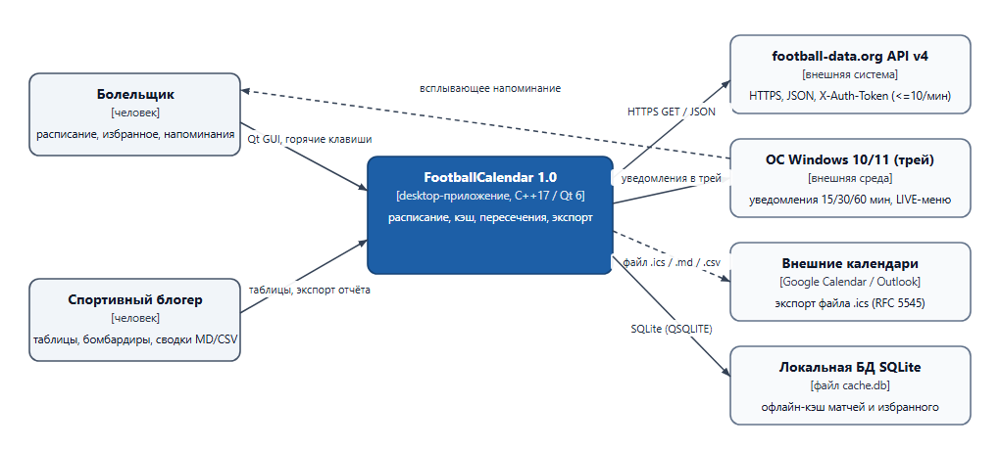
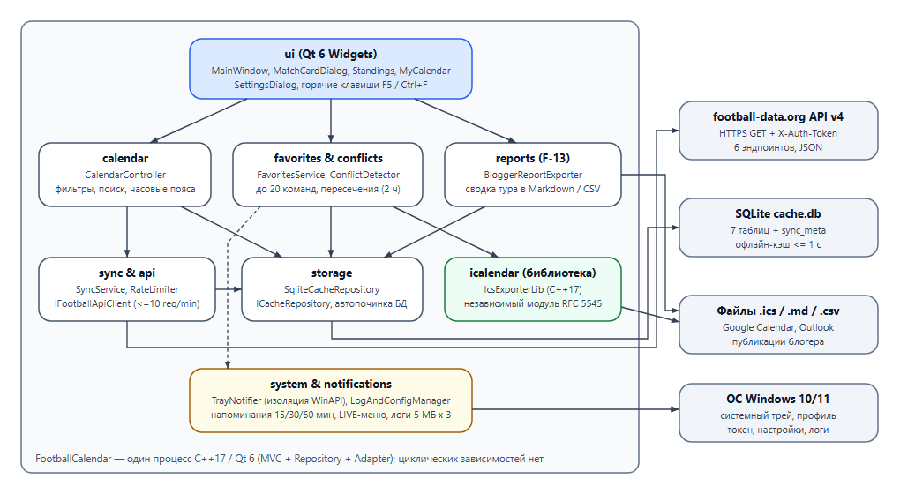
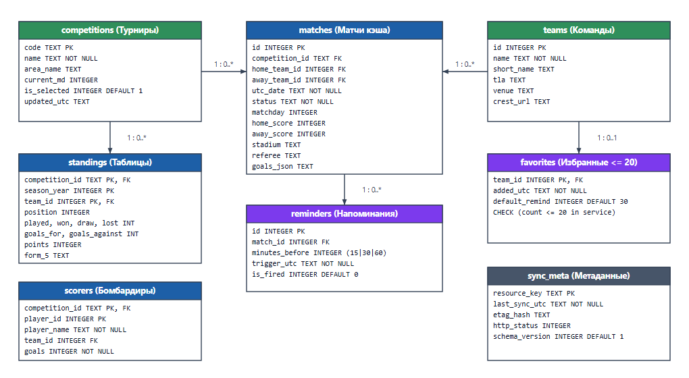
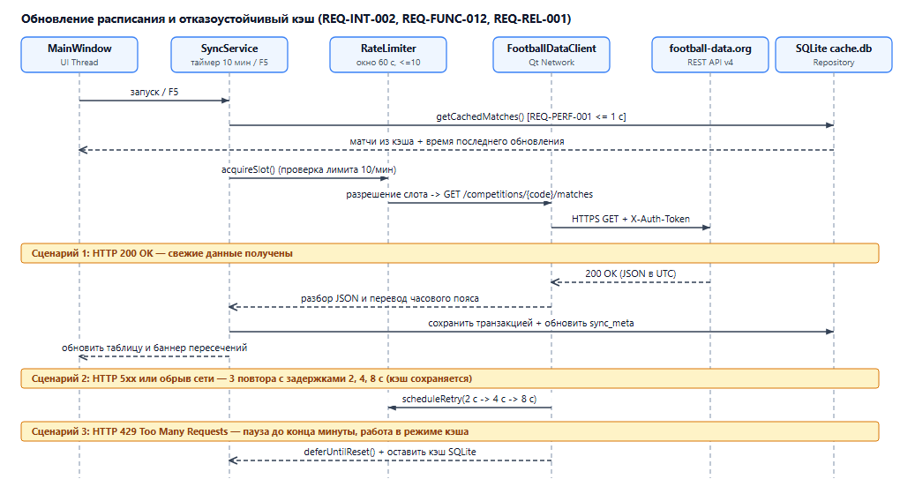

# Описание дизайна программного обеспечения

Для «Футбольный календарь» (FootballCalendar) — информационная система просмотра расписания и статистики футбольных матчей

Версия 0.3

Подготовил Коньков Я. А., гр. 434701

БГУИР, кафедра ЭВМ

2026-11-22

## Оглавление

<!-- TOC -->
* [1. Введение](#1-introduction)
  * [1.1 Назначение документа](#11-document-purpose)
  * [1.2 Область применения](#12-subject-scope)
  * [1.3 Определения, акронимы и сокращения](#13-definitions-acronyms-and-abbreviations)
  * [1.4 Ссылки](#14-references)
  * [1.5 Обзор документа](#15-document-overview)
* [2. Обзор дизайна](#2-design-overview)
  * [2.1 Задачи стейкхолдеров](#21-stakeholder-concerns)
  * [2.2 Выбранные точки зрения](#22-selected-viewpoints)
  * [2.3 Системные требования](#23-system-requirements)
* [3. Проектные представления](#3-design-views)
* [4. Решения](#4-decisions)
* [5. Приложения](#5-appendixes)
<!-- TOC -->

## История изменений

| Имя | Дата | Причина изменений | Версия |
|-----|------|-------------------|--------|
| Коньков Я. А. | 2026-11-21 | Первоначальная версия описания дизайна, системных требований и плана v1 | 0.1 |
| Коньков Я. А. | 2026-11-22 | Обновление приоритетов и упрощения по итогам 1-го раунда переговоров с Заказчиком (план v2) | 0.2 |
| Коньков Я. А. | 2026-11-22 | Исключение `SYS-F-08`, добавление `SYS-F-13` (модуль `reports` и LIVE-меню трея), `ADR-0005` и план v3 с `junior`-разработчиком | 0.3 |

---

## 1. Введение {#1-introduction}

### 1.1 Назначение документа {#11-document-purpose}

Настоящее описание дизайна ПО (**SDD**, *Software Design Description*) переводит согласованные требования из спецификации [srs/FootballCalendar/srs.md](../../srs/FootballCalendar/srs.md) («**ЧТО** должна делать система») в предписывающую архитектуру («**КАК** система построена внутри»). Документ служит руководством для ведущего и подключаемого `junior`-разработчиков, основой для модульного и интеграционного тестирования и согласованным техническим приложением к плану итераций [plan.md](plan.md).

### 1.2 Область применения {#12-subject-scope}

Проектируемая система — настольное приложение **«Футбольный календарь» (`FootballCalendar`) версии 1.0** для Windows 10/11 (x64), разрабатываемое на **C++17** с использованием фреймворка **Qt 6** (`Widgets`, `Network`, `Sql`) и встроенной СУБД **SQLite** (`C-1`…`C-5`).

Архитектура обеспечивает бизнес-цели `BG-1`…`BG-4` и включает:
- асинхронный клиент к `football-data.org` REST API v4 с ограничителем `<= 10 запросов/мин` и повторами `2, 4, 8 с` (`REQ-INT-002`, `REQ-FUNC-012`, `REQ-REL-001`);
- локальный кэш SQLite (`cache.db`) на `<= 2000` матчей со временем открытия `<= 1 с` и автовосстановлением при повреждении (`REQ-PERF-001`, `REQ-REL-002`, `REQ-AVAIL-001`);
- персональный календарь избранных команд (до 20 клубов), детектор пересечений матчей по времени (2 ч, `REQ-FUNC-011`) и системные уведомления в трее Windows (`REQ-INT-003`, `REQ-FUNC-009`);
- независимую библиотеку генерации `.ics` по стандарту `RFC 5545` (`REQ-FUNC-010`, `SRS 3.5.5`) и модуль выгрузки аналитической сводки тура в Markdown/CSV с быстрым меню трея «Матчи сегодня / LIVE» (`REQ-FUNC-015`, добавлен во 2-м раунде).

### 1.3 Определения, акронимы и сокращения {#13-definitions-acronyms-and-abbreviations}

| Термин | Определение |
|--------|-------------|
| ADR / MADR | Architecture Decision Record / Markdown ADR — протокол значимого архитектурного решения |
| API | Application Programming Interface — программный интерфейс внешнего сервиса (`football-data.org` v4) |
| DTO | Data Transfer Object — структура данных передачи между слоями без прикладной логики |
| ER-модель | Entity-Relationship Diagram — логическая модель таблиц базы данных SQLite |
| iCalendar (.ics) | Стандарт обмена календарными событиями по RFC 5545 |
| MVC | Model–View–Controller — разделение интерфейса, контроллеров и хранилища данных |
| Rate Limiter | Компонент ограничения частоты запросов (скользящее окно 10 запросов / 60 с) |
| SDD | Software Design Description — описание проектирования ПО (IEEE 1016-2009) |
| Viewpoint / View | Точка зрения и проектное представление архитектуры (ISO/IEC/IEEE 42010:2011) |

### 1.4 Ссылки {#14-references}

| Документ | Версия | Тип |
|----------|--------|-----|
| Спецификация требований [srs/FootballCalendar/srs.md](../../srs/FootballCalendar/srs.md) | 0.2 | Нормативный |
| План реализации по итерациям [sdd/FootballCalendar/plan.md](plan.md) | 0.3 | Нормативный |
| Переписка с Заказчиком [sdd/FootballCalendar/correspondence.md](correspondence.md) | 0.3 | Справочный |
| IEEE Std 1016-2009 — Software Design Descriptions | 2009 | Нормативный |
| ISO/IEC/IEEE 42010:2011 — Architecture Description | 2011 | Нормативный |
| Протоколы решений [ADR-0001](../../adr/FootballCalendar/0001-mvc-and-api-abstraction.md) … [ADR-0005](../../adr/FootballCalendar/0005-blogger-digest-and-tray-menu.md) | 1.0 | Нормативный |
| Документация `football-data.org` API (`https://www.football-data.org/documentation/api`) | v4 | Нормативный |
| RFC 5545 — iCalendar Core Object Specification | 2009 | Нормативный |

### 1.5 Обзор документа {#15-document-overview}

Раздел 2 описывает задачи стейкхолдеров, выбранные точки зрения (*Viewpoints*) и каталог системных требований (`SYS-F-01`…`SYS-F-13`, `SYS-NF-01`…`SYS-NF-07`). Раздел 3 содержит шесть проектных представлений (`DV-01`…`DV-06`) с графическими схемами. Раздел 4 фиксирует принятые архитектурные решения (`ADR-0001`…`ADR-0005`). Раздел 5 содержит полную матрицу трассируемости требований `SRS -> SYS -> DV -> ADR`.

---

## 2. Обзор дизайна {#2-design-overview}

### 2.1 Задачи стейкхолдеров {#21-stakeholder-concerns}

| Стейкхолдер | Интересы и задачи (Concerns) | Адресующие элементы |
|-------------|------------------------------|---------------------|
| **Заказчик** (Кузьминчук М. Ю.) | Прозрачные сроки и бюджет, жёсткий дедлайн `18.12.2026`, приоритет «изюминки» и модуля для блогера | `plan.md`, `correspondence.md`, `2.3`, `DV-06` |
| **Болельщик** | Поиск матча `<= 30 с` (`BG-1`), работа офлайн `<= 1 с` (`BG-4`), напоминания в трее и предупреждения о пересечениях (`BG-2`) | `DV-01`, `DV-04`, `DV-05`, `DV-06`, `ADR-0002`, `ADR-0003` |
| **Спортивный блогер** | Таблицы, топ-10 бомбардиров (`BG-3`) и мгновенная выгрузка сводки тура в Markdown/CSV (`SYS-F-13`) | `DV-02`, `DV-04`, `ADR-0005` |
| **Ведущий разработчик / Архитектор** | Отсутствие циклических зависимостей (`MVC`), соблюдение квоты 10 req/min, изоляция модулей для параллельной работы с `junior` | `DV-02`, `DV-03`, `DV-05`, `ADR-0001`…`0005` |
| **Junior-разработчик** | Понятные контракты DTO/интерфейсов, изолированность верстаемых окон и шаблонов экспорта от сетевой логики | `DV-02`, `DV-03`, `ADR-0001`, `ADR-0005` |

### 2.2 Выбранные точки зрения {#22-selected-viewpoints}

Из 15 точек зрения стандарта ISO/IEC/IEEE 42010 выбраны **11 активных** (сгруппированных в `DV-01`…`DV-06`):
- **Выбраны:** `Контекст` (`DV-01`), `Композиция`, `Структура` и `Зависимости` (`DV-02`), `Логическое представление`, `Интерфейс` и `Паттерны` (`DV-03`), `Информация` (`DV-04`), `Взаимодействие`, `Параллелизм` и `Динамика состояний` (`DV-05`), `Алгоритм` (`DV-06`), `Ресурсы` и `Развёртывание` (описаны в `DV-04` и `ADR-0004`: один процесс Windows x64, `windeployqt`, ОЗУ `<= 200 МБ`, логи `3 × 5 МБ`).
- **Не применимо отдельно:** `Физическое представление` — приложение выполняется локально на одном ПК пользователя (`SRS 3.1.2`, `3.5.3`) без серверных узлов.

### 2.3 Системные требования {#23-system-requirements}

Требования `SRS v0.2` сгруппированы в **13 функциональных системных требований** (`SYS-F-01`…`SYS-F-13`) с приоритетами от `10` (наивысший) до `50` (минимальный) и **7 нефункциональных системных требований** (`SYS-NF-01`…`SYS-NF-07`).

#### 2.3.1 Функциональные системные требования

| ID | Function (EN) | Приоритет (`v3`) | Требования SRS | Зависит от | Оценка Middle, ч | Итерации (`v3`) |
|----|---------------|------------------|----------------|------------|------------------|-----------------|
| `SYS-F-01` | Core & SQLite cache | `10` | `C-1`, `C-4`, `REQ-PERF-001`, `REQ-REL-002`, `REQ-AVAIL-001` | — | `14` | `1` |
| `SYS-F-02` | Football-Data API client & rate limiter | `10` | `REQ-INT-002`, `REQ-FUNC-012`, `REQ-SEC-001`, `REQ-REL-001`, `REQ-PERF-002` | `SYS-F-01` | `16` | `1` |
| `SYS-F-03` | Main window & match schedule | `10` | `REQ-INT-001`, `REQ-FUNC-001`, `REQ-FUNC-013`, `REQ-COMP-001` | `SYS-F-01`, `SYS-F-02` | `14` | `2` |
| `SYS-F-04` | Settings, timezone & localization | `20` | `REQ-FUNC-014`, `REQ-SEC-002`, `REQ-SEC-003` | `SYS-F-01` | `6` | `2` |
| `SYS-F-05` | Tournament filter & live team search | `20` | `REQ-FUNC-002`, `REQ-FUNC-003` | `SYS-F-03` | `8` | `2` |
| `SYS-F-06` | Match details card & head-to-head | `20` | `REQ-FUNC-004` | `SYS-F-02`, `SYS-F-03` | `8` *(J: 12)* | `3` |
| `SYS-F-07` | Standings & top scorers | `30` | `REQ-FUNC-005`, `REQ-FUNC-006` | `SYS-F-02`, `SYS-F-03` | `10` | `4` |
| `SYS-F-08` | Team statistics & form (10+5) | *отложено* | `REQ-FUNC-007` *(отложено в v0.2)* | `SYS-F-02`, `SYS-F-03` | `—` | *после 1.0* |
| `SYS-F-09` | Favorites & personal calendar | `10` | `REQ-FUNC-008` | `SYS-F-01`, `SYS-F-03` | `8` | `3` |
| `SYS-F-10` | Match overlap detection | `10` | `REQ-FUNC-011` | `SYS-F-09` | `6` | `3` |
| `SYS-F-11` | Windows tray notifications & reminders | `20` | `REQ-INT-003`, `REQ-FUNC-009` | `SYS-F-09` | `8` | `3` |
| `SYS-F-12` | iCalendar (.ics) library, logger & release | `30` | `REQ-FUNC-010`, `REQ-OBS-001`, `REQ-COMP-002`, `REQ-COMP-003` | `SYS-F-09` | `10` *(M: 6, J: 6)* | `4` |
| `SYS-F-13` | Blogger digest (MD/CSV) & tray LIVE menu | `20` | `REQ-FUNC-015` *(добавлено в v0.2)* | `SYS-F-07`, `SYS-F-09`, `SYS-F-11` | `22` *(M: 14, J: 12)* | `3–4` |
| **Итого** | — | — | — | — | **`130`** | **1–4** |

---

- **ID:** `SYS-F-01`
- **Title:** Core & SQLite cache
- **Priority:** `10`
- **Description:** Система должна инициализировать локальную базу данных SQLite (`cache.db`) с семью нормализованными таблицами и индексами, проверять целостность `PRAGMA quick_check` и автоматически пересоздавать повреждённый файл кэша без аварийного завершения.
- **Source:** `C-1`, `C-4`, `REQ-PERF-001`, `REQ-REL-002`, `REQ-AVAIL-001`
- **Design:** `DV-02`, `DV-04`, `ADR-0002`

---

- **ID:** `SYS-F-02`
- **Title:** Football-Data API client & rate limiter
- **Priority:** `10`
- **Description:** Сетевой адаптер `FootballDataApiClient` должен асинхронно запрашивать 6 эндпоинтов `football-data.org` v4 по HTTPS с заголовком `X-Auth-Token`, соблюдать лимит скользящего окна `<= 10 запросов/60 с`, выполнять 3 повтора (`2, 4, 8 с`) при `5xx`/сбое сети и ставить очередь на паузу при `HTTP 429`.
- **Source:** `C-3`, `REQ-INT-002`, `REQ-FUNC-012`, `REQ-SEC-001`, `REQ-REL-001`, `REQ-PERF-002`
- **Design:** `DV-01`, `DV-03`, `DV-05`, `ADR-0001`, `ADR-0003`

---

- **ID:** `SYS-F-03`
- **Title:** Main window & match schedule
- **Priority:** `10`
- **Description:** Главное окно (`>= 1024×640`) должно отображать 4 вкладки, расписание матчей за день, неделю (Пн–Вс) или месяц с переводом времени из UTC в часовой пояс пользователя, горячие клавиши (`F5`, `Ctrl+F`, стрелки), офлайн-кэш с меткой времени и строку атрибуции `football-data.org`.
- **Source:** `REQ-INT-001`, `REQ-FUNC-001`, `REQ-FUNC-013`, `REQ-COMP-001`
- **Design:** `DV-01`, `DV-02`, `DV-03`

---

- **ID:** `SYS-F-04`
- **Title:** Settings, timezone & localization
- **Priority:** `20`
- **Description:** Диалог настроек должен сохранять API-токен в профиле пользователя Windows (без записи в логи), часовой пояс (по умолчанию системный) и язык интерфейса (`ru`/`en` через `QTranslator`).
- **Source:** `REQ-FUNC-014`, `REQ-SEC-002`, `REQ-SEC-003`
- **Design:** `DV-02`

---

- **ID:** `SYS-F-05`
- **Title:** Tournament filter & live team search
- **Priority:** `20`
- **Description:** Панель фильтров должна сохранять выбранные турниры в SQLite между запусками и фильтровать таблицу матчей по регистронезависимой подстроке названия команды длиной `>= 2` символов.
- **Source:** `REQ-FUNC-002`, `REQ-FUNC-003`
- **Design:** `DV-02`, `DV-04`

---

- **ID:** `SYS-F-06`
- **Title:** Match details card & head-to-head
- **Priority:** `20`
- **Description:** По двойному клику на строку матча диалог `MatchCardDialog` должен отображать команды, счёт, турнир, тур, стадион, судью, таблицу голов (или пояснение при отсутствии) и последние 5 личных встреч.
- **Source:** `REQ-FUNC-004`
- **Design:** `DV-02`, `DV-03`

---

- **ID:** `SYS-F-07`
- **Title:** Standings & top scorers
- **Priority:** `30`
- **Description:** Вкладка «Таблицы» должна выводить отсортированную турнирную таблицу выбранной лиги и сезона (с формой за 5 игр) и список не менее 10 лучших бомбардиров с общим табличным компонентом.
- **Source:** `REQ-FUNC-005`, `REQ-FUNC-006`
- **Design:** `DV-02`, `DV-04`

---

- **ID:** `SYS-F-09`
- **Title:** Favorites & personal calendar
- **Priority:** `10`
- **Description:** Сервис `FavoritesService` должен позволять добавлять до 20 избранных команд с сохранением в SQLite, блокировать 21-ю команду сообщением и формировать вкладку «Мой календарь».
- **Source:** `REQ-FUNC-008`
- **Design:** `DV-02`, `DV-04`

---

- **ID:** `SYS-F-10`
- **Title:** Match overlap detection
- **Priority:** `10`
- **Description:** Сервис `ConflictDetector` должен выявлять пересечения интервалов `[start, start + 120 мин)` для матчей избранных команд, подсвечивать конфликтные строки и выводить предупреждение в `conflictBanner`.
- **Source:** `REQ-FUNC-011`
- **Design:** `DV-02`, `DV-06`

---

- **ID:** `SYS-F-11`
- **Title:** Windows tray notifications & reminders
- **Priority:** `20`
- **Description:** Планировщик напоминаний должен показывать системное уведомление Windows в трее за 15, 30 или 60 минут до матча избранной команды с отклонением `<= 1 мин` (включая свёрнутое состояние приложения).
- **Source:** `REQ-INT-003`, `REQ-FUNC-009`, `SRS 3.5.6`
- **Design:** `DV-01`, `DV-02`, `ADR-0004`

---

- **ID:** `SYS-F-12`
- **Title:** iCalendar (.ics) library, logger & release
- **Priority:** `30`
- **Description:** Автономная библиотека `icalendar_exporter` должна формировать файл `.ics` на 60 дней вперёд по `RFC 5545` (совместимость с Google Calendar и Outlook); логгер ведёт ротацию `3 × 5 МБ`; дистрибутив Windows x64 собирается с динамической линковкой Qt (`windeployqt`).
- **Source:** `REQ-FUNC-010`, `REQ-OBS-001`, `REQ-COMP-002`, `REQ-COMP-003`, `SRS 3.5.1`, `3.5.5`
- **Design:** `DV-02`, `DV-06`, `ADR-0004`

---

- **ID:** `SYS-F-13`
- **Title:** Blogger digest (MD/CSV) & tray LIVE menu
- **Priority:** `20`
- **Description:** Модуль `BloggerReportExporter` должен формировать сводку текущего тура с выгрузкой в Markdown и CSV (`UTF-8 BOM`) из локального кэша SQLite, а `TrayNotifier` — показывать контекстное меню «Матчи сегодня / LIVE» без дополнительных запросов к API.
- **Source:** `BG-1`, `BG-3`, `REQ-FUNC-015` (v0.2)
- **Design:** `DV-01`, `DV-02`, `ADR-0005`

---

#### 2.3.2 Нефункциональные системные требования

- **`SYS-NF-01` Performance (`10`):** открытие до 2000 матчей из кэша `<= 1 с` на ПК с 4 ГБ ОЗУ за счёт индексов SQLite `idx_matches_utc_date` и `idx_matches_comp_date`; обновление турнира `<= 5 с`; потребление ОЗУ `<= 200 МБ` (`REQ-PERF-001`…`003`).
- **`SYS-NF-02` Security (`10`):** обмен с API строго по `HTTPS`; хранение `X-Auth-Token` в профиле Windows и маскировка перед записью в журнал; отсутствие сбора персональных данных (`REQ-SEC-001`…`003`).
- **`SYS-NF-03` Reliability (`10`):** 3 экспоненциальные попытки (`2, 4, 8 с`) при `5xx`/сбое сети; пауза при `429` без удаления кэша; автопересоздание битого `cache.db` через `PRAGMA quick_check` (`REQ-REL-001`, `002`).
- **`SYS-NF-04` Availability (`10`):** полноценный просмотр расписания, таблиц, карточек и экспорт отчётов в автономном режиме из `cache.db` (`REQ-FUNC-013`, `REQ-AVAIL-001`).
- **`SYS-NF-05` Observability (`20`):** ротируемый журнал уровней `INFO`, `WARNING`, `ERROR` в `%LOCALAPPDATA%\FootballCalendar` размером до `5 МБ` и не более `3` файлов (`REQ-OBS-001`).
- **`SYS-NF-06` Maintainability & Portability (`20`):** слоистая архитектура MVC, отсутствие циклических зависимостей, независимая библиотека `.ics`, изоляция `WinAPI` в `TrayNotifier` (`SRS 3.5.4`…`3.5.6`).
- **`SYS-NF-07` Compliance & Cost (`10`):** строка атрибуции API в `StatusBar`, динамическая линковка Qt (`LGPL v3`), стандарт `RFC 5545`, нулевой бюджет инструментов и API (`REQ-COMP-001`…`003`, `SRS 3.5.7`).

---

## 3. Проектные представления {#3-design-views}

### DV-01: Контекстная диаграмма системы

- **ID:** `DV-01`
- **Title:** Контекст системы и внешние интерфейсы
- **Viewpoint:** Контекст (`Context`) и Интерфейс (`Interface`)
- **Требования SRS:** `REQ-INT-001`, `REQ-INT-002`, `REQ-INT-003`, `REQ-SEC-001`, `REQ-COMP-001`, `REQ-FUNC-015`
- **Решения:** `ADR-0001`, `ADR-0005`
- **Representation:**

Приложение работает как автономный desktop-клиент без собственного сервера: общается с двумя классами пользователей (Болельщик и Спортивный блогер), запрашивает 6 эндпоинтов `football-data.org` API v4 по HTTPS (`X-Auth-Token`), кэширует данные в `SQLite cache.db`, выводит уведомления и меню LIVE через трей Windows и экспортирует файлы `.ics`, `.md` и `.csv`.

---

### DV-02: Модули приложения и их зависимости

- **ID:** `DV-02`
- **Title:** Композиция модулей и направленность зависимостей
- **Viewpoint:** Композиция (`Composition`), Структура (`Structure`), Зависимости (`Dependency`)
- **Требования SRS:** `C-1`…`C-5`, `REQ-FUNC-001`…`015`, `SRS 3.5.4`…`3.5.6`
- **Решения:** `ADR-0001`, `ADR-0004`, `ADR-0005`
- **Representation:**

Приложение строится как модульный монолит на C++17 / Qt 6 с 8 изолированными модулями и строгой иерархией зависимостей сверху вниз (циклические зависимости исключены). Выделение модулей `icalendar`, `reports` и `system & notifications` позволяет вести параллельную разработку ведущему и `junior`-разработчикам без конфликтов.

---

### DV-03: Логические контракты интерфейсов и паттерны

- **ID:** `DV-03`
- **Title:** Основные интерфейсы C++17 / Qt 6 и архитектурные паттерны
- **Viewpoint:** Логическое представление (`Logical`), Интерфейс (`Interface`), Паттерны (`Patterns`)
- **Требования SRS:** `REQ-INT-002`, `REQ-FUNC-001`…`015`, `SRS 3.5.4`
- **Решения:** `ADR-0001`, `ADR-0003`, `ADR-0004`, `ADR-0005`
- **Representation:**

Применены паттерны **MVC**, **Repository** (`ICacheRepository` -> `SqliteCacheRepository`), **Adapter / Strategy** (`IFootballApiClient` -> `FootballDataApiClient`) и **Sliding Window Rate Limiter** (`RateLimiter`):
- `ICacheRepository`: `saveMatches()`, `getMatches(filter)`, `getStandings(code)`, `getScorers(code)`, `getFavorites()`, `rebuildIfCorrupted()`.
- `IFootballApiClient`: `fetchCompetitions()`, `fetchMatches(code, from, to)`, `fetchStandings(code)`, `fetchScorers(code)`, `fetchMatchDetails(id)`.
- `INotificationService`: `showReminder(match, minutesBefore)`, `updateTodayLiveMenu(matches)`.
- `IcsExporter` (автономная библиотека без зависимостей от Qt Widgets/SQL): `exportToFile(events, path)`, `validateRfc5545(text)`.

---

### DV-04: Логическая модель данных кэша SQLite

- **ID:** `DV-04`
- **Title:** ER-схема локальной базы данных `cache.db`
- **Viewpoint:** Информация (`Information`) и Ресурсы (`Resources`)
- **Требования SRS:** `C-4`, `REQ-FUNC-001`…`009`, `REQ-FUNC-013`, `REQ-PERF-001`, `REQ-PERF-003`, `REQ-REL-002`, `REQ-AVAIL-001`
- **Решения:** `ADR-0002`
- **Representation:**

Схема включает справочники `competitions` и `teams` (зелёные), игровые кэш-таблицы `matches`, `standings`, `scorers` (синие), пользовательские таблицы `favorites` (`<= 20`) и `reminders` (фиолетовые), а также служебную таблицу `sync_meta` для вывода метки времени последнего обновления (`REQ-FUNC-013`). Индексы `idx_matches_utc_date` и `idx_matches_comp_date` гарантируют чтение 2000 матчей быстрее 1 с (`REQ-PERF-001`).

---

### DV-05: Асинхронное обновление, RateLimiter и отказоустойчивость

- **ID:** `DV-05`
- **Title:** Сценарий фонового обновления данных и обработка ошибок API
- **Viewpoint:** Взаимодействие (`Interaction`), Параллелизм (`Concurrency`), Динамика состояний (`State Dynamics`)
- **Требования SRS:** `REQ-INT-002`, `REQ-FUNC-012`, `REQ-FUNC-013`, `REQ-PERF-001`, `REQ-PERF-002`, `REQ-REL-001`, `REQ-SEC-001`
- **Решения:** `ADR-0002`, `ADR-0003`
- **Representation:**

Состояния модуля синхронизации: `Idle` -> `Syncing` -> `BackoffRetry` (`2, 4, 8 с` при `5xx`/сбое сети) / `OfflineCached` (при `429` или отсутствии сети с сохранением данных в `cache.db`). Сетевые вызовы идут асинхронно через `QNetworkAccessManager` без блокировки UI-потока.

---

### DV-06: Алгоритмы детектора пересечений и экспорта iCalendar

- **ID:** `DV-06`
- **Title:** Алгоритм `ConflictDetector` (окно 2 ч) и структура файла `.ics` (`RFC 5545`)
- **Viewpoint:** Алгоритм (`Algorithm`) и Структура (`Structure`)
- **Требования SRS:** `REQ-FUNC-010`, `REQ-FUNC-011`, `REQ-COMP-003`, `SRS 3.5.5`
- **Решения:** `ADR-0004`
- **Representation:**

1. **Поиск пересечений матчей избранных команд (`O(n log n)`):** предстоящие матчи избранных команд представляются интервалами `[utc_date, utc_date + 120 мин)` и сортируются по возрастанию начала. Если `start[j] < end[i]`, оба матча помечаются флагом конфликта и попадают в `conflictBanner` экрана `UI-04`.
2. **Экспорт `.ics`:** для матчей на 60 дней вперёд генерируется `VCALENDAR 2.0` со стандартными блоками `VEVENT` (`UID`, `DTSTART`, `DTEND`, `SUMMARY`, `LOCATION`) и `VALARM` с окончаниями строк `CRLF` и свёрткой длинных строк по 75 байт.

---

## 4. Решения {#4-decisions}

- **ID:** `ADR-0001` — **Архитектура MVC и изоляция внешнего API за `IFootballApiClient`** ([файл](../../adr/FootballCalendar/0001-mvc-and-api-abstraction.md)). Выбрана слоистая архитектура MVC вместо *Smart UI* и QML; обеспечивает тестирование с mock-объектами и распределение задач с `junior`-разработчиком (`SRS 3.5.4`).

---

- **ID:** `ADR-0002` — **Встроенная СУБД SQLite для локального кэша** ([файл](../../adr/FootballCalendar/0002-sqlite-for-local-cache.md)). Выбран `QSQLITE` с индексами и проверкой `PRAGMA quick_check` вместо JSON-файлов и `QSettings`; выполняет `C-4`, `REQ-PERF-001` (`<= 1 с`) и `REQ-REL-002`.

---

- **ID:** `ADR-0003` — **Ограничитель `RateLimiter` (Sliding Window 10/мин) и повторы `2/4/8 с`** ([файл](../../adr/FootballCalendar/0003-rate-limiter-and-retry-policy.md)). Выбрана асинхронная очередь со скользящим окном 60 с вместо фиксированной паузы 6 с; одновременно выполняет `REQ-FUNC-012`, `REQ-PERF-002` (`<= 5 с`) и `REQ-REL-001`.

---

- **ID:** `ADR-0004` — **Независимая библиотека `icalendar_exporter`, динамическая линковка Qt (`LGPL v3`) и изоляция `WinAPI`** ([файл](../../adr/FootballCalendar/0004-standalone-icalendar-and-winapi-isolation.md)). Выполняет `REQ-COMP-002`, `REQ-COMP-003`, `SRS 3.5.5` и `3.5.6`.

---

- **ID:** `ADR-0005` — **Аналитическая сводка тура (MD/CSV) и LIVE-меню трея поверх локального кэша SQLite** ([файл](../../adr/FootballCalendar/0005-blogger-digest-and-tray-menu.md)). Добавлено во 2-м раунде; гарантирует нулевой расход квоты 10 запросов/мин, офлайн-работу и простое делегирование генератора отчётов `junior`-разработчику.

---

## 5. Приложения {#5-appendixes}

### Матрица трассируемости (`SRS -> Системные требования -> Представления SDD -> ADR`)

| Требования SRS | Системное требование | Представления SDD | Протоколы ADR |
|----------------|----------------------|-------------------|---------------|
| `C-1`, `C-4`, `REQ-PERF-001`, `REQ-REL-002`, `REQ-AVAIL-001` | `SYS-F-01`, `SYS-NF-01`, `SYS-NF-03`, `SYS-NF-04` | `DV-02`, `DV-04` | `ADR-0002` |
| `C-3`, `REQ-INT-002`, `REQ-FUNC-012`, `REQ-SEC-001`, `REQ-REL-001`, `REQ-PERF-002` | `SYS-F-02`, `SYS-NF-02`, `SYS-NF-03` | `DV-01`, `DV-03`, `DV-05` | `ADR-0001`, `ADR-0003` |
| `REQ-INT-001`, `REQ-FUNC-001`, `REQ-FUNC-013`, `REQ-COMP-001` | `SYS-F-03`, `SYS-NF-04`, `SYS-NF-07` | `DV-01`, `DV-02`, `DV-03` | `ADR-0001` |
| `REQ-FUNC-014`, `REQ-SEC-002`, `REQ-SEC-003` | `SYS-F-04`, `SYS-NF-02` | `DV-02` | `ADR-0002` |
| `REQ-FUNC-002`, `REQ-FUNC-003` | `SYS-F-05` | `DV-02`, `DV-04` | `ADR-0002` |
| `REQ-FUNC-004` | `SYS-F-06` | `DV-02`, `DV-03` | `ADR-0001` |
| `REQ-FUNC-005`, `REQ-FUNC-006` | `SYS-F-07` | `DV-02`, `DV-04` | `ADR-0002` |
| `REQ-FUNC-007` *(отложено в SRS v0.2)* | `SYS-F-08` *(отложено)* | — | — |
| `REQ-FUNC-008` | `SYS-F-09` | `DV-02`, `DV-04` | `ADR-0002` |
| `REQ-FUNC-011` | `SYS-F-10` | `DV-02`, `DV-06` | `ADR-0001` |
| `REQ-INT-003`, `REQ-FUNC-009`, `SRS 3.5.6` | `SYS-F-11`, `SYS-NF-06` | `DV-01`, `DV-02` | `ADR-0004` |
| `REQ-FUNC-010`, `REQ-OBS-001`, `REQ-PERF-003`, `REQ-COMP-002`, `REQ-COMP-003` | `SYS-F-12`, `SYS-NF-05`, `SYS-NF-06`, `SYS-NF-07` | `DV-02`, `DV-06` | `ADR-0004` |
| `BG-1`, `BG-3`, `REQ-FUNC-015` *(добавлено в SRS v0.2)* | `SYS-F-13` | `DV-01`, `DV-02`, `DV-03` | `ADR-0005` |

### Связанные файлы планирования и переписки

- Планы по итерациям `v1`–`v3` и диаграммы Ганта: [plan.md](plan.md) (`images/plan-v1.png`, `images/plan-v2.png`, `images/plan-v3.png`).
- Полная переписка с Заказчиком (Раунд 1 и Раунд 2): [correspondence.md](correspondence.md).
