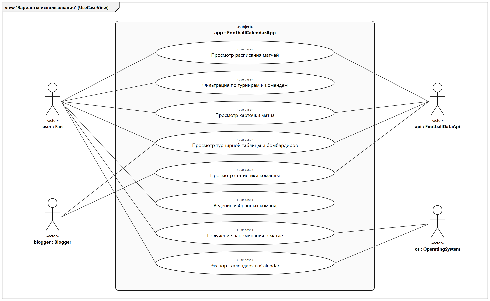
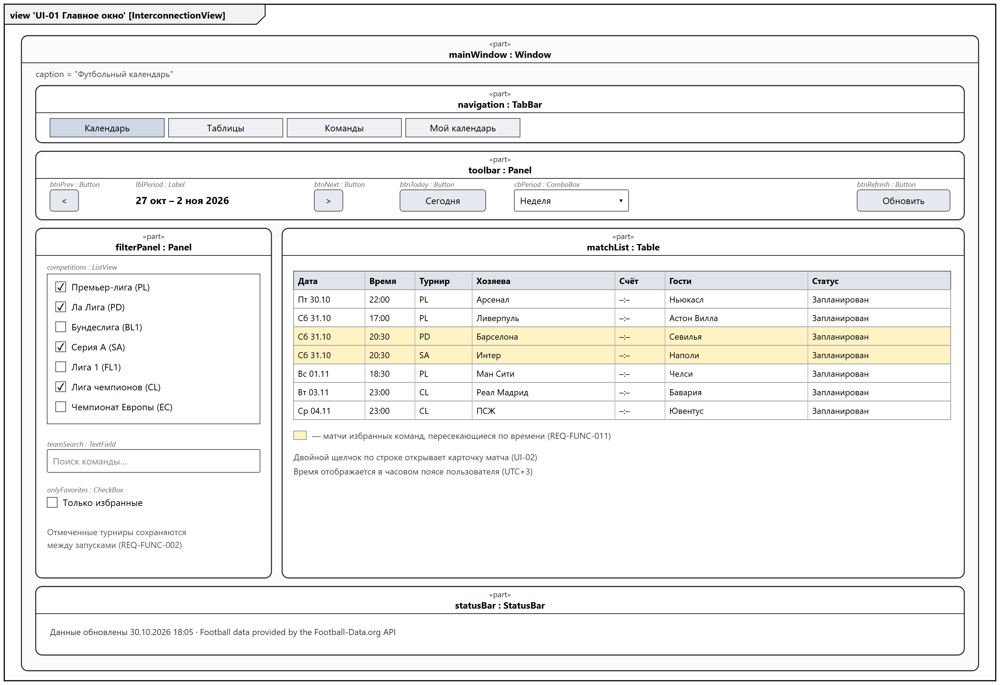
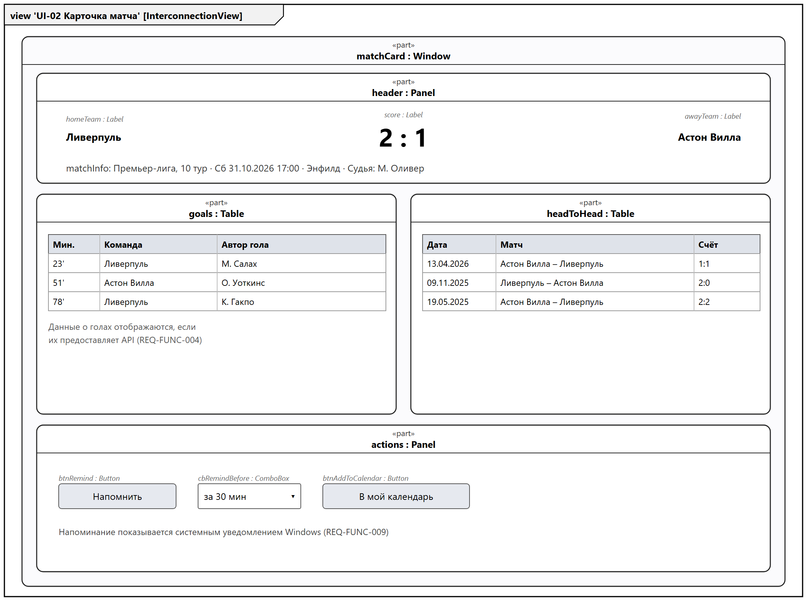
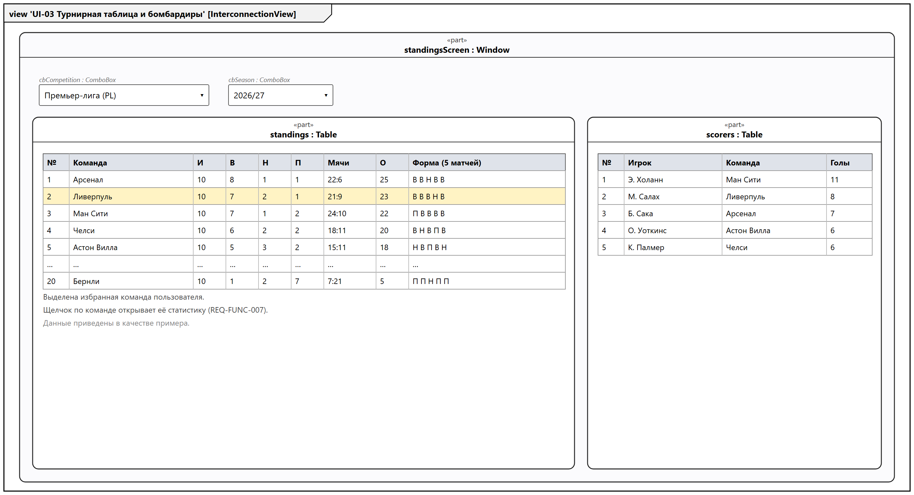
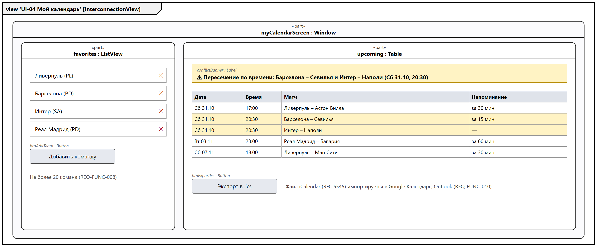

# Спецификация требований к ПО

Для «Футбольный календарь» (FootballCalendar) — информационная система просмотра расписания и статистики футбольных матчей

Версия 0.1

Подготовил Коньков Я. А., гр. 434701

БГУИР, кафедра ЭВМ

30.10.2026

## Оглавление

<!-- TOC -->
* [1. Введение](#1-introduction)
  * [1.1 Назначение документа](#11-document-purpose)
  * [1.2 Область применения продукта](#12-product-scope)
  * [1.3 Определения, акронимы и сокращения](#13-definitions-acronyms-and-abbreviations)
  * [1.4 Ссылки](#14-references)
  * [1.5 Обзор документа](#15-document-overview)
* [2. Обзор продукта](#2-product-overview)
  * [2.1 Перспектива продукта](#21-product-perspective)
  * [2.2 Функции продукта](#22-product-functions)
  * [2.3 Ограничения продукта](#23-product-constraints)
  * [2.4 Характеристики пользователей](#24-user-characteristics)
  * [2.5 Допущения и зависимости](#25-assumptions-and-dependencies)
  * [2.6 Распределение требований](#26-apportioning-of-requirements)
* [3. Требования](#3-requirements)
  * [3.1 Внешние интерфейсы](#31-external-interfaces)
  * [3.2 Функциональные требования](#32-functional)
  * [3.3 Качество обслуживания](#33-quality-of-service)
  * [3.4 Соответствие стандартам](#34-compliance)
  * [3.5 Проектирование и реализация](#35-design-and-implementation)
  * [3.6 ИИ/МО](#36-aiml)
* [4. Верификация](#4-verification)
* [5. Приложения](#5-appendixes)
<!-- TOC -->

## История изменений

| Name | Date | Reason For Changes | Version |
|------|------|--------------------|---------|
| Коньков Я. А. | 30.10.2026 | Первоначальная версия по результатам интервью с Заказчиком | 0.1 |
|      |      |                    |         |

---

## 1. Введение {#1-introduction}

Документ описывает требования к desktop-приложению «Футбольный календарь», которое собирает в одном окне расписание, результаты и статистику матчей ведущих футбольных турниров. Ниже определены назначение документа и границы продукта (раздел 1), контекст и пользователи (раздел 2), верифицируемые требования (раздел 3) и способы их проверки (раздел 4).

### 1.1 Назначение документа {#11-document-purpose}

Документ фиксирует, **что** должно делать приложение, и служит договорённостью между Заказчиком и командой разработки. Разработчик использует его для проектирования (SDD) и реализации, тестировщик — для составления тестов по матрице раздела 4, Заказчик — для приёмки. Документ ведётся в репозитории проекта и изменяется только через pull request.

### 1.2 Область применения продукта {#12-product-scope}

«Футбольный календарь» версии 1.0 — desktop-приложение для Windows, которое загружает данные о матчах из открытого сервиса football-data.org и показывает:
- календарь матчей выбранных турниров за день, неделю или месяц;
- карточку матча, турнирные таблицы, список бомбардиров и статистику команды;
- персональный календарь избранных команд с напоминаниями и экспортом в формат iCalendar.

Бизнес-цели продукта:
- **BG-1.** Болельщик находит время и место нужного матча не более чем за 30 с, без поиска по нескольким сайтам.
- **BG-2.** Болельщик не пропускает матчи любимых команд благодаря напоминаниям.
- **BG-3.** Пользователь получает основную статистику (таблица, бомбардиры, форма команды) в том же приложении.
- **BG-4.** Расписание остаётся доступным без подключения к интернету (по последним загруженным данным).

Не входят в область продукта: видеотрансляции, ставки и коэффициенты, текстовые онлайн-трансляции с обновлением чаще одного раза в минуту, мобильная и веб-версии, учётные записи пользователей и облачная синхронизация.

### 1.3 Определения, акронимы и сокращения {#13-definitions-acronyms-and-abbreviations}

| Term | Definition |
|------|------------|
| API | Application Programming Interface — программный интерфейс внешнего сервиса |
| HTTPS | HyperText Transfer Protocol Secure — защищённый протокол передачи данных |
| iCalendar (.ics) | Формат обмена календарными данными по RFC 5545 |
| JSON | JavaScript Object Notation — текстовый формат обмена данными |
| SRS | Software Requirements Specification — спецификация требований к ПО |
| SysML v2 | Systems Modeling Language v2 — язык моделирования систем, использован для графической части |
| UI | User Interface — пользовательский интерфейс |
| Избранная команда | Команда, отмеченная пользователем для персонального календаря и напоминаний |
| Кэш | Локальная копия последних загруженных данных |
| Турнир | Соревнование, предоставляемое API (например, PL — английская Премьер-лига) |

### 1.4 Ссылки {#14-references}

| Документ | Версия | Тип |
|----------|--------|-----|
| ISO/IEC/IEEE 29148:2018 Requirements engineering | 2018 | Нормативный |
| Документация football-data.org API, https://www.football-data.org/documentation/api | v4 | Нормативный |
| RFC 5545 Internet Calendaring and Scheduling (iCalendar) | 2009 | Нормативный |
| Модель интерфейса `model/football-calendar-ui.sysml` | 0.1 | Справочный |
| Мокапы экранов `images/*.png` | 0.1 | Справочный |

### 1.5 Обзор документа {#15-document-overview}

Раздел 2 описывает контекст, пользователей и ограничения. Раздел 3 содержит требования с уникальными идентификаторами вида `REQ-AREA-NNN`. Раздел 4 — матрица верификации. Раздел 5 — ссылки на графическую часть. Изменения вносятся через pull request и фиксируются в истории изменений.

---

## 2. Обзор продукта {#2-product-overview}

### 2.1 Перспектива продукта {#21-product-perspective}

Продукт новый, самостоятельный, разрабатывается в рамках курса ЖЦРПО. Источник данных — внешний сервис football-data.org (REST API v4). Приложение не имеет собственного сервера: данные загружаются напрямую клиентом и хранятся в локальном кэше. Взаимодействие с ОС — системные уведомления Windows и сохранение файлов .ics. Контекст показан на диаграмме вариантов использования (`images/uc-use-cases.png`).

### 2.2 Функции продукта {#22-product-functions}

- Просмотр календаря матчей за день, неделю, месяц.
- Фильтрация матчей по турнирам, поиск по команде.
- Карточка матча: счёт, голы, место, судья, история личных встреч.
- Турнирная таблица и список бомбардиров.
- Статистика команды: последние матчи и форма.
- Избранные команды и персональный календарь.
- Напоминания о матчах избранных команд.
- Выявление пересечения матчей избранных команд по времени.
- Экспорт персонального календаря в iCalendar.
- Работа с кэшем при отсутствии сети.

### 2.3 Ограничения продукта {#23-product-constraints}

- **C-1.** Приложение должно быть реализовано на C++17 с использованием фреймворка Qt 6 (модули Widgets, Network, Sql).
- **C-2.** Приложение должно работать под Windows 10 и Windows 11 (x64).
- **C-3.** Единственный источник футбольных данных — football-data.org API v4 на бесплатном тарифе (не более 10 запросов в минуту, ограниченный набор турниров).
- **C-4.** Для хранения кэша должна использоваться встроенная СУБД SQLite.
- **C-5.** Обязательно указание источника данных в интерфейсе (условие использования API).

### 2.4 Характеристики пользователей {#24-user-characteristics}

| Класс | Описание | Частота | Ключевые потребности |
|-------|----------|---------|----------------------|
| Болельщик (основной) | Опытный пользователь ПК, следит за 1–5 командами | Ежедневно, 2–5 мин | Расписание, напоминания, результаты |
| Спортивный блогер | Готовит публикации о турах | Несколько раз в неделю | Таблицы, бомбардиры, форма команд |

Интерфейс на русском языке с возможностью переключения на английский; время отображается в часовом поясе пользователя.

### 2.5 Допущения и зависимости {#25-assumptions-and-dependencies}

| Допущение / зависимость | Влияние, если неверно |
|-------------------------|-----------------------|
| API football-data.org доступен и сохраняет формат v4 | Требуется адаптация модуля загрузки данных |
| Бесплатный тариф покрывает 12 основных турниров | Сокращение списка турниров или платный тариф |
| Данные о голах доступны для завершённых матчей | Карточка матча показывает только счёт |
| У пользователя есть личный API-токен (бесплатная регистрация) | Без токена доступен только кэш |

### 2.6 Распределение требований {#26-apportioning-of-requirements}

| Релиз | Требования |
|-------|------------|
| 0.5 (прототип) | REQ-FUNC-001, 002, 004, 012, 013, 014 |
| 1.0 | Все остальные требования раздела 3 |
| Отложено | Мобильная версия, синхронизация между устройствами |

---

## 3. Требования {#3-requirements}

Ключевые слова: «должна» — обязательное требование, «следует» — желательное, «может» — необязательное.

### 3.1 Внешние интерфейсы {#31-external-interfaces}

#### 3.1.1 Пользовательские интерфейсы {#311-user-interfaces}

- **ID:** REQ-INT-001
- **Title:** Структура главного окна
- **Statement:** Главное окно должно содержать вкладки «Календарь», «Таблицы», «Команды», «Мой календарь», панель навигации по периоду, панель фильтров, таблицу матчей и строку состояния с временем последнего обновления.
- **Rationale:** Все основные функции доступны не более чем в два действия.
- **Acceptance Criteria:** Окно соответствует мокапу UI-01.
- **Verification Method:** Inspection
- **More Information:** `images/ui-01-main-window.png`

Мокапы экранов: UI-01 главное окно (`images/ui-01-main-window.png`), UI-02 карточка матча (`images/ui-02-match-card.png`), UI-03 таблицы (`images/ui-03-standings.png`), UI-04 мой календарь (`images/ui-04-my-calendar.png`). Минимальный размер окна — 1024×640 пикселей; все действия доступны с клавиатуры (F5 — обновить, Ctrl+F — поиск команды, стрелки влево/вправо — смена периода).

#### 3.1.2 Аппаратные интерфейсы {#312-hardware-interfaces}

Специальные аппаратные интерфейсы не требуются. Нужны ПК с Windows 10/11 x64 и подключение к интернету для обновления данных.

#### 3.1.3 Программные интерфейсы {#313-software-interfaces}

- **ID:** REQ-INT-002
- **Title:** Интеграция с football-data.org
- **Statement:** Приложение должно получать данные по HTTPS из API football-data.org v4 (ресурсы `/competitions`, `/competitions/{code}/matches`, `/competitions/{code}/standings`, `/competitions/{code}/scorers`, `/teams/{id}/matches`, `/matches/{id}`), передавая токен в заголовке `X-Auth-Token`.
- **Rationale:** Единственный выбранный источник данных (C-3).
- **Acceptance Criteria:** Ответы в формате JSON корректно отображаются на экранах UI-01…UI-04; ошибки 4xx/5xx обрабатываются по REQ-REL-001.
- **Verification Method:** Test

- **ID:** REQ-INT-003
- **Title:** Системные уведомления
- **Statement:** Напоминания должны показываться через область уведомлений Windows (значок в системном трее).
- **Verification Method:** Demonstration

### 3.2 Функциональные требования {#32-functional}

- **ID:** REQ-FUNC-001
- **Title:** Календарь матчей
- **Statement:** Система должна показывать матчи выбранных турниров за выбранный период (день, неделя, месяц) в виде таблицы: дата, время, турнир, хозяева, счёт, гости, статус.
- **Rationale:** BG-1.
- **Acceptance Criteria:** При выборе «Неделя» отображаются все матчи с понедельника по воскресенье текущей недели, отсортированные по времени начала.
- **Verification Method:** Test

- **ID:** REQ-FUNC-002
- **Title:** Фильтр по турнирам
- **Statement:** Пользователь должен иметь возможность отметить один или несколько турниров; выбор сохраняется между запусками.
- **Acceptance Criteria:** После перезапуска приложения отмеченные турниры восстановлены.
- **Verification Method:** Test

- **ID:** REQ-FUNC-003
- **Title:** Поиск команды
- **Statement:** Система должна фильтровать таблицу матчей по подстроке названия команды (без учёта регистра) по мере ввода.
- **Verification Method:** Test

- **ID:** REQ-FUNC-004
- **Title:** Карточка матча
- **Statement:** По двойному щелчку по матчу система должна открывать карточку: команды, счёт, турнир и тур, дата и время, стадион, судья, голы (если предоставлены API), последние 5 личных встреч.
- **Verification Method:** Demonstration
- **More Information:** `images/ui-02-match-card.png`

- **ID:** REQ-FUNC-005
- **Title:** Турнирная таблица
- **Statement:** Система должна показывать таблицу выбранного турнира и сезона: место, команда, игры, победы, ничьи, поражения, мячи, очки, форма за 5 матчей.
- **Verification Method:** Test
- **More Information:** `images/ui-03-standings.png`

- **ID:** REQ-FUNC-006
- **Title:** Бомбардиры
- **Statement:** Система должна показывать не менее 10 лучших бомбардиров выбранного турнира.
- **Verification Method:** Test

- **ID:** REQ-FUNC-007
- **Title:** Статистика команды
- **Statement:** Система должна показывать для команды последние 10 матчей с результатами, количество забитых и пропущенных мячей и ближайшие 5 матчей.
- **Rationale:** BG-3.
- **Verification Method:** Test

- **ID:** REQ-FUNC-008
- **Title:** Избранные команды
- **Statement:** Пользователь должен иметь возможность добавить в избранное до 20 команд и удалить их; список хранится локально.
- **Acceptance Criteria:** При попытке добавить 21-ю команду выводится сообщение об ограничении.
- **Verification Method:** Test
- **More Information:** `images/ui-04-my-calendar.png`

- **ID:** REQ-FUNC-009
- **Title:** Напоминания о матчах
- **Statement:** Для матча избранной команды пользователь должен иметь возможность включить напоминание за 15, 30 или 60 минут до начала; напоминание показывается, если приложение запущено (в том числе свёрнуто в трей).
- **Rationale:** BG-2.
- **Acceptance Criteria:** Уведомление появляется с отклонением не более 1 минуты от заданного времени.
- **Verification Method:** Test

- **ID:** REQ-FUNC-010
- **Title:** Экспорт в iCalendar
- **Statement:** Система должна экспортировать ближайшие матчи избранных команд (до 60 дней вперёд) в файл .ics по RFC 5545.
- **Acceptance Criteria:** Файл без ошибок импортируется в Google Календарь и Microsoft Outlook.
- **Verification Method:** Test

- **ID:** REQ-FUNC-011
- **Title:** Пересечение матчей избранных команд
- **Statement:** Если интервалы двух и более матчей избранных команд пересекаются (длительность матча принимается равной 2 ч), система должна выделять такие матчи и показывать предупреждение в «Моём календаре».
- **Rationale:** «Изюминка» продукта: болельщик заранее выбирает, какой матч смотреть.
- **Verification Method:** Test

- **ID:** REQ-FUNC-012
- **Title:** Обновление данных
- **Statement:** Система должна обновлять данные при запуске, по кнопке «Обновить» (F5) и автоматически каждые 10 минут, не превышая 10 запросов к API в минуту.
- **Verification Method:** Test

- **ID:** REQ-FUNC-013
- **Title:** Работа без сети
- **Statement:** При недоступности API система должна показывать данные из кэша и время их последнего обновления.
- **Rationale:** BG-4.
- **Verification Method:** Test

- **ID:** REQ-FUNC-014
- **Title:** Настройки
- **Statement:** Пользователь должен иметь возможность задать API-токен, часовой пояс (по умолчанию системный) и язык интерфейса (русский, английский).
- **Verification Method:** Demonstration

### 3.3 Качество обслуживания {#33-quality-of-service}

#### 3.3.1 Производительность {#331-performance}

- **REQ-PERF-001.** Открытие календаря из кэша (до 2000 матчей) — не более 1 с на ПК с 4 ГБ ОЗУ.
- **REQ-PERF-002.** Обновление данных одного турнира при скорости соединения от 10 Мбит/с — не более 5 с.
- **REQ-PERF-003.** Потребление оперативной памяти — не более 200 МБ.

#### 3.3.2 Безопасность {#332-security}

- **REQ-SEC-001.** Обмен данными с API должен выполняться только по HTTPS.
- **REQ-SEC-002.** API-токен хранится в профиле пользователя Windows и не записывается в журнал.
- **REQ-SEC-003.** Приложение не собирает и не передаёт персональные данные пользователя.

#### 3.3.3 Надёжность {#333-reliability}

- **REQ-REL-001.** При ошибке сети или ответе 5xx выполняется до 3 повторных попыток с экспоненциальной задержкой (2, 4, 8 с); при ответе 429 запрос откладывается до окончания лимита. Ранее загруженные данные при этом не удаляются.
- **REQ-REL-002.** Повреждение файла кэша не должно приводить к аварийному завершению: кэш пересоздаётся, пользователь получает сообщение.

#### 3.3.4 Доступность {#334-availability}

- **REQ-AVAIL-001.** Функции просмотра должны быть доступны без сети в режиме кэша (REQ-FUNC-013).

#### 3.3.5 Наблюдаемость {#335-observability}

- **REQ-OBS-001.** Приложение ведёт журнал (уровни INFO, WARNING, ERROR) в профиле пользователя с ротацией по 5 МБ, не более 3 файлов.

### 3.4 Соответствие стандартам {#34-compliance}

- **REQ-COMP-001.** В строке состояния должна отображаться надпись «Football data provided by the Football-Data.org API» (C-5).
- **REQ-COMP-002.** Библиотеки Qt подключаются динамически в соответствии с лицензией LGPL v3.
- **REQ-COMP-003.** Файл экспорта соответствует RFC 5545.

### 3.5 Проектирование и реализация {#35-design-and-implementation}

#### 3.5.1 Установка {#351-installation}

Поставка — установщик для Windows x64, включающий библиотеки Qt (windeployqt). Удаление через «Приложения и возможности» без остатков, кроме пользовательских настроек (по запросу).

#### 3.5.2 Сборка и поставка {#352-build-and-delivery}

Сборка через CMake 3.25+ компилятором MSVC 2022 или MinGW 13. Версии — по схеме SemVer, каждая версия отмечается тегом в репозитории.

#### 3.5.3 Распределение {#353-distribution}

Не применимо: приложение работает локально на одном ПК.

#### 3.5.4 Сопровождаемость {#354-maintainability}

Архитектура с разделением на модель, представление и контроллер; модуль доступа к API изолирован интерфейсом, чтобы можно было заменить источник данных. Комментарии и документация на русском языке.

#### 3.5.5 Повторное использование {#355-reusability}

Модуль генерации iCalendar следует оформить как независимую библиотеку.

#### 3.5.6 Переносимость {#356-portability}

Целевая ОС — Windows; код не должен использовать WinAPI напрямую вне модуля уведомлений, чтобы в дальнейшем возможна была сборка под Linux.

#### 3.5.7 Стоимость {#357-cost}

Использование только бесплатных инструментов и бесплатного тарифа API.

#### 3.5.8 Сроки {#358-deadline}

Этапы соответствуют лабораторным работам курса: требования (ЛР3), проектирование, реализация прототипа 0.5, релиз 1.0 к концу семестра.

#### 3.5.9 Доказательство концепции {#359-proof-of-concept}

До реализации проверить: доступность выбранных турниров на бесплатном тарифе, наличие голов и судей в ответах API, достаточность лимита 10 запросов в минуту для автообновления.

#### 3.5.10 Управление изменениями {#3510-change-management}

Изменения требований вносятся только через pull request с ревью Заказчика; каждая принятая правка увеличивает версию документа и записывается в историю изменений.

### 3.6 ИИ/МО {#36-aiml}

Не применимо: продукт не содержит компонентов машинного обучения.

---

## 4. Верификация {#4-verification}

| Requirement ID | Verification Method | Test/Artifact Link | Status | Evidence |
|----------------|---------------------|--------------------|--------|----------|
| REQ-INT-001 | Inspection | images/ui-01-main-window.png | Planned | |
| REQ-INT-002 | Test | tests/api-client.md | Planned | |
| REQ-FUNC-001 | Test | tests/UC01-calendar.md | Planned | |
| REQ-FUNC-002 | Test | tests/UC02-filter.md | Planned | |
| REQ-FUNC-004 | Demonstration | images/ui-02-match-card.png | Planned | |
| REQ-FUNC-005 | Test | tests/UC04-standings.md | Planned | |
| REQ-FUNC-008 | Test | tests/UC06-favorites.md | Planned | |
| REQ-FUNC-009 | Test | tests/UC07-reminders.md | Planned | |
| REQ-FUNC-010 | Test | tests/UC08-ics-export.md | Planned | |
| REQ-FUNC-011 | Test | tests/UC06-conflicts.md | Planned | |
| REQ-FUNC-013 | Test | tests/offline-mode.md | Planned | |
| REQ-PERF-001 | Test | tests/performance.md | Planned | |
| REQ-SEC-001 | Inspection | Анализ сетевого трафика | Planned | |
| REQ-REL-001 | Test | tests/api-errors.md | Planned | |

---

## 5. Приложения {#5-appendixes}

- Модель SysML v2: [`model/football-calendar-ui.sysml`](model/football-calendar-ui.sysml)
- Диаграмма вариантов использования: 
- UI-01 Главное окно: 
- UI-02 Карточка матча: 
- UI-03 Турнирная таблица и бомбардиры: 
- UI-04 Мой календарь: 
